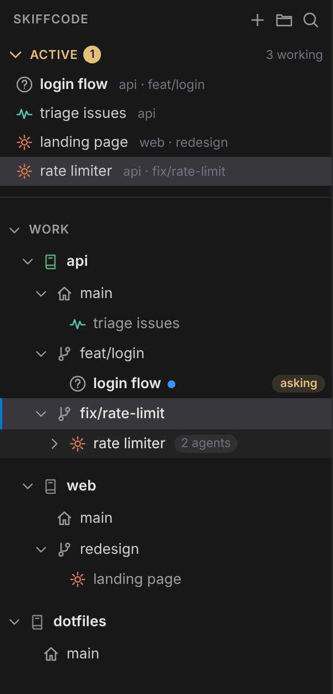

# SkiffCode

A light, Orca-style workspace for **repos → git worktrees → Claude Code sessions**: a code editor, terminals and VS Code-style git in one app window. It runs next to your repos (on Linux, or in WSL on Windows) and opens as a browser app window.



**Claude sessions**
- Several Claude sessions and shells per worktree; they keep running when you close the window, restart SkiffCode or reboot (they resume where they left off)
- Name sessions when you start them; names stay in sync with Claude both ways (rename here, or `/rename` in Claude)
- **Active panel**: every session waiting for you or working; one click opens it
- At a glance: orange Claude icon while working, a zigzag while a command it started runs, ❓ / 🛡 when it needs you
- **Alerts** for questions, permission prompts and finished work: a sound per alert (built-in or your own file, with volume) and desktop notifications
- **Subagents** counted on their session; click to list them with their type
- **Resume past conversations**, including ones started elsewhere (a terminal, Orca): pick from the worktree's list or paste `claude --resume <id>`
- **Delete a session for good**: its Claude conversation goes too, so it's gone from `/resume`; removing a worktree or folder can do the same for all of its conversations
- **Claude usage** (5-hour / weekly, time to reset) in the status bar; switch between Claude logins and orgs

**Repos and git**
- Repos, git worktrees and plain folders in groups, in your own order, with your own icon and color
- **Instant switching**: each worktree keeps its own tabs, splits, terminals and bottom panel
- New worktree from any base branch with your branch name, or one command: `skiffcode new`
- Stage, discard, commit, push / pull (Ctrl/Shift+click selects several changed files), editable diffs, review vs base; commits expand to their files; a History pane below lists the whole branch log
- Plain folders work too (no git); `git init` there and git features turn on

**Editor and app**
- Monaco editor with syntax colors for ~80 languages and F12 go-to-definition; quick open and search
- **Drag and drop** like VS Code: files from Explorer into a folder (copied in) or onto a Claude session (attached); from the Files panel onto a folder (moved), an editor pane (opened) or a session (`@path`)
- **Viewers**: images and PDFs open in a tab; HTML pages (and SVG) get a live preview to the side that reloads as files change
- **Paths in terminals are links**, Claude’s output included: an HTML report opens in your browser on click, or as a preview inside SkiffCode on Ctrl+click; code opens in the editor at its line; right-click for more. Works with Linux, `C:\…` and `\\wsl.localhost\…` paths
- **Web pages in a tab**: Ctrl+click a link in a terminal or the editor to open it inside SkiffCode (a plain click in a terminal opens your browser), or the globe button for a new tab where you type a web address or paste a file path; sites that refuse to be embedded get an “Open in your browser” button
- Terminals: select and right-click to copy, right-click to paste; Ctrl+C copies a selection, Ctrl+V pastes
- Panel background colors, comfortable or compact sidebar, idle worktrees unload to save memory

<br clear="right">

## Runs on

| | |
|---|---|
| **Windows** | in **WSL** (where Claude Code runs); opens as an Edge app window, with Windows notifications and a Start menu entry |
| **Linux** | natively; opens in Chrome / Chromium / Edge as an app window (or any browser), notifications via `notify-send`, sounds via PipeWire / PulseAudio |
| macOS | not yet |

## Install

Needs Node.js 18+, python3, git and Claude Code. In WSL or your Linux terminal:

```bash
curl -fsSL https://raw.githubusercontent.com/ykim-xr/skiffcode/main/install.sh | bash
skiffcode ~/code/my-repo
```

Optional: `sudo apt install ripgrep` for faster search.

| Command | |
|---|---|
| `skiffcode [dir]` | open SkiffCode (and add / show a repo or folder) |
| `skiffcode new <repo> <branch> [-b <base>] --name <session> [--prompt <text>]` | worktree for the branch (created if needed, from `<base>`, e.g. `origin/develop`, fetched first) + a named Claude session in it |
| `skiffcode claude <worktree> --name <session> [--prompt <text>]` | another Claude session in a worktree or folder |
| `skiffcode list [--json]` | repos, worktrees and sessions |
| `skiffcode update` | update to the latest version; sessions keep running |
| `skiffcode status` · `stop` · `restart` · `logs` · `version` | manage the server |
| `~/.local/share/skiffcode/src/uninstall.sh` | uninstall (`--purge` also removes settings) |

`new` and `claude` also take `--prompt -` (prompt from stdin), `--no-claude`, `--no-show` and `--json`, so scripts and Claude skills can set up workspaces.

## Keys

| | |
|---|---|
| Ctrl+P · Ctrl+Shift+P | open a file · all commands |
| Ctrl+Alt+J · Ctrl+Alt+K | jump to a session · next session that needs you |
| Ctrl+Alt+N · Ctrl+\` | new Claude session · new shell |
| Ctrl+Shift+\` · Ctrl+B | bottom panel · sidebar |
| Ctrl+Shift+F · E · G | search · files · source control |
| Ctrl+Alt+D | review changes vs base |
| F12 · Shift+F12 | go to definition · references |

## How it works

A dependency-free Node server (127.0.0.1 only, token-protected) serves the UI and keeps each session in its own terminal host, so sessions outlive the window and the server. Claude runs as plain `claude` with a hooks and status-line file passed via `--settings`: your `~/.claude` settings are never edited, and your own status line still runs. Data lives in `~/.local/share/skiffcode`.

Tests: `node test/api.test.js` and `node test/ui.test.js` (Playwright).

## License

MIT
